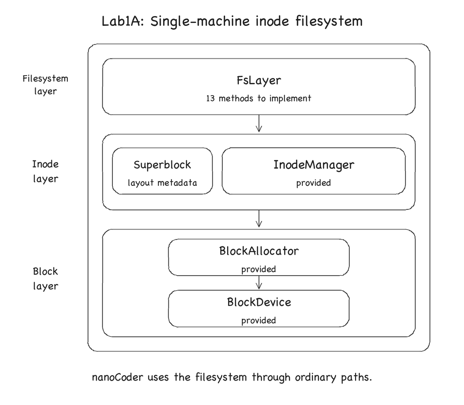
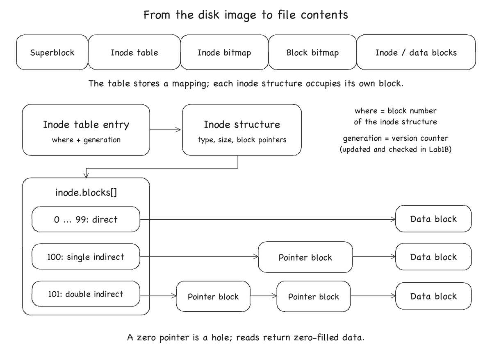
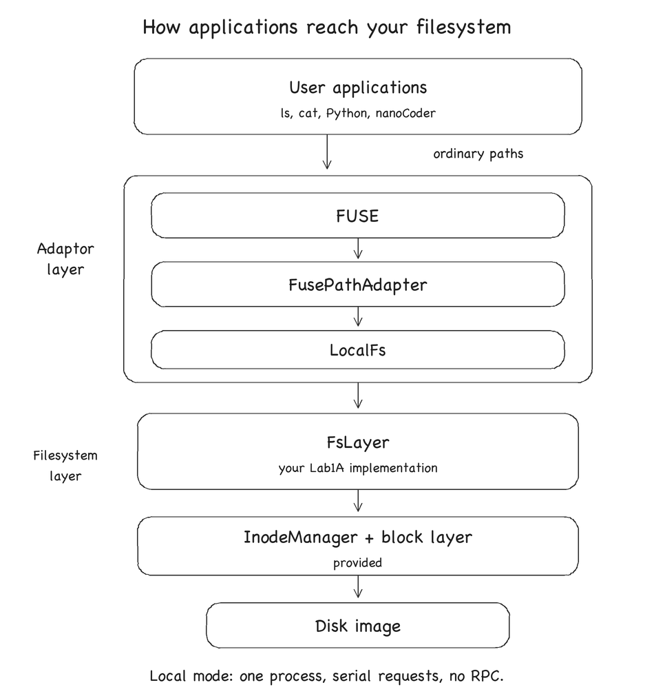

# Lab1A: Single-machine inode filesystem

## Introduction

In this part, you will implement file reads and writes, directory operations and
space reclamation. First complete the [environment setup](lab1.md#docker-container).

You have to implement the 13 functions marked `TODO Lab1A` in
[`nanofs/src/fs.cc`](../../nanofs/src/fs.cc). **Only modify the marked function
bodies in this file.** Keep the function signatures unchanged. The public
`read_file`, `write_file`, `readdir`, `create` and `mkdir` wrappers are provided.

## Filesystem Structure

Our filesystem has three layers:



- The block layer provides a block device and a bitmap allocator.
- The inode layer stores inodes and manages inode allocation and the superblock.
- The filesystem layer implements the file and directory operations in this lab.

The first two layers are provided. Read
[`block.h`](../../nanofs/include/nanofs/block.h),
[`inode.h`](../../nanofs/include/nanofs/inode.h) and
[`fs.h`](../../nanofs/include/nanofs/fs.h) before starting. `FsLayer` also calls
the block layer directly to access file content and indirect blocks.

The disk image has the following layout:



The inode table maps an inode number to the block holding its inode structure.
Each inode occupies its own block and records the file type, size and block
pointers. Leave the inode table's generation field unchanged in Lab1A.

There are 100 direct pointers, one single-indirect pointer and one double-indirect
pointer. An indirect block contains block numbers. The figure shows one example
path for each type of pointer. Block 0 holds the superblock and is not available
for allocation. A zero content pointer represents a hole in the file.

## Part 1: Block Mapping and File Data

Implement the following functions:

- `logical_to_physical_block`: find the disk block for a logical block index,
  allocating missing blocks when requested.
- `read_bytes`: read a byte range from an inode.
- `write_bytes`: write a byte range and save the updated inode and file size.
- `getattr`: return the inode number, file type and size.
- `setattr`: change the file size.

### Block Addressing

Use the block size passed to the function, or read it from the superblock when
needed. **Do not assume that a block is always 4096 bytes.** Tests use both 512-byte
and 4096-byte blocks.

A `block_id` is 4 bytes. Let `P = bs / sizeof(block_id)` be the number of pointers
in an indirect block. The logical block indices are:

| Type | Logical block indices (end excluded) |
| --- | --- |
| Direct | `[0, NDIRECT)` |
| Single indirect | `[NDIRECT, NDIRECT + P)` |
| Double indirect | `[NDIRECT + P, NDIRECT + P + P*P)` |

For 512-byte blocks, these ranges are 0–99, 100–227 and 228–16611. Reject an index
outside the capacity before allocating any blocks.

When `allocate` is false, return `NULL_BLOCK` if any pointer along the path is
missing. Do not allocate blocks for a read. When allocating, zero both new content
blocks and new pointer blocks. Write changes to pointer blocks back to the device;
the caller must also save any changed pointers in the inode.

The `super()` helper reads the superblock. Construct the allocator for file
content and indirect blocks as follows:

```cpp
BlockAllocator balloc(dev_, sb->block_bitmap_start, sb->block_bitmap_blocks,
                      sb->data_start, sb->num_blocks);
```

It manages blocks in `[data_start, num_blocks)`. The inode bitmap is for allocating
inode numbers, not these blocks.

### Reading, Writing and Truncating

Stop reads at the end of the file. A read starting at or beyond EOF returns an
empty string. Fill holes with zeros. For a partial-block write, preserve the bytes
outside the written range.

When shrinking a file, free discarded content blocks and any indirect blocks that
are no longer needed. Clear their pointers, and zero the unused tail of the last
retained content block. Keep indirect blocks that still point to retained data.
Growing a file changes its size without allocating the added range. Shrinking and
then growing must not expose old data or leave pointers to freed blocks.

If this part is correct, the `LogicalToPhysical`, `ReadBytes`, `WriteBytes`,
`Getattr` and `Setattr` suites should pass. The provided wrappers also have
`ReadFile` and `WriteFile` tests. See
[Unit Tests](lab1.md#unit-tests) for the commands, and
[`test_fs.cc`](../../nanofs/test/test_fs.cc) for the test cases.

## Part 2: Directories and Creation

A directory is a file containing 64-byte `DirEntry` records. Each record stores
an inode number and a NUL-terminated name of at most 59 bytes. An inode number of
zero marks an unused slot. Do not store `.` or `..` entries; the FUSE adaptor
supplies them when listing a directory.

Implement the following functions:

- `read_dir_entries`: read the records and return the live entries.
- `lookup`: find a name in a parent directory.
- `add_dir_entry`: reuse an unused slot, or append a record if none is available.
- `remove_dir_entry`: clear the matching record by zeroing the entire slot.
- `make_node`: allocate and link a new inode for `create` and `mkdir`.

Removing an entry does not shrink the directory file. **A directory is empty when
it has no live entries, not when its size is zero.** `readdir` and `rmdir` must
ignore unused slots.

If linking a newly allocated inode into its parent fails, free that inode,
including its structure block, before returning the error. If a name already
exists, creation returns that inode even when its type differs from the requested
type.

If this part is correct, the `Lookup`, `Readdir`, `AddDirEntry` and `MakeNode`
suites should pass. Entry removal is also checked by the deletion tests below.

## Part 3: Deletion and Space Reclamation

Implement the following functions:

- `free_file_blocks`: free all content and indirect blocks, clear the inode's block
  pointers and set its size to zero. This helper does not save the inode or free
  its structure block; the caller does that.
- `unlink`: remove a file's directory entry and reclaim its blocks and inode.
- `rmdir`: remove an empty directory and reclaim its blocks and inode.

Deleting a name that is already absent succeeds. Reclaim both levels of pointer
blocks for large files so that the freed space can be reused.

If this part is correct, the `Unlink` and `Rmdir` suites should pass. The
`FusePathAdapter` suite checks directory and file operations through the provided
adaptor.

## Error Handling

The interfaces return `Result<T>`, containing either a value or an `Error`.
Use the following results for invalid operations. Each row assumes the other
arguments are valid; no particular check order is required when several arguments
are invalid.

| Operation / condition | Required result |
| --- | --- |
| `logical_to_physical_block`: index outside addressable capacity | `Error::Invalid` |
| `logical_to_physical_block`: unallocated path with `allocate=false` | `NULL_BLOCK` (successful hole lookup) |
| `read_bytes`: starts at or beyond EOF | Empty string |
| `read_bytes`: range extends past EOF | Return only bytes before EOF |
| `read_file`, `write_file`, `setattr`: target is a directory | `Error::IsDir` |
| `read_file` / `write_file`: offset plus length overflows the supported 32-bit range | `Error::Invalid` (checked by provided wrappers) |
| `lookup`, `read_dir_entries` / `readdir`: inode is not a directory | `Error::NotDir` |
| `lookup`: name is absent | `Error::NotFound` |
| `make_node` / `create` / `mkdir`: parent is not a directory | `Error::NotDir` |
| `add_dir_entry` / creation: name length is 60 bytes or more | `Error::Invalid` |
| `create` / `mkdir`: name already exists | Return existing inode, even if its type differs from the requested type |
| `unlink`: named target is a directory | `Error::IsDir` |
| `rmdir`: named target is a regular file | `Error::NotDir` |
| `rmdir`: directory has any live entry | `Error::NotEmpty` |
| `unlink` / `rmdir` / `remove_dir_entry`: name absent in a valid directory | Success |
| Block or inode allocation is exhausted | Propagate `Error::NoSpace` |

Propagate errors from inode and block operations. In particular, an I/O error is
not a hole or a missing directory entry, and must not cause `make_node` to create
a new inode. Read the helper comments in `fs.h` for checks performed by callers.

The lab assumes functioning storage for space-reclamation tests. You do not need
to implement atomic rollback after injected storage failures or recovery after a
crash. File operations are served serially, and a clean unmount flushes the image.

## Adaptor Layer: From Applications to Your Filesystem

Applications such as `ls` and `cat` use ordinary paths. To let them access your
filesystem, we provide a FUSE adaptor that translates their requests into calls
to your implementation:



`FusePathAdapter` resolves path components, and `LocalFs` calls `FsLayer` with inode
numbers. Your code then reads the inode and the file's blocks. You can find the
FUSE callbacks in `nanofs/fuse-adaptor/main.cc`.

Application requests pass through the kernel to the nanoFS mount program,
which handles them serially.

## Playing with Your Filesystem

After completing the functions above and passing the unit tests, you can try your
filesystem with ordinary shell commands. Use the FUSE-enabled container from
[Docker Container](lab1.md#docker-container).

In the container's terminal, build the mount program and start it:

```sh
cd /work
cmake -S . -B "$NANOFS_BUILD_DIR" -DNANOFS_STAGE_B=OFF -DNANOFS_REQUIRE_FUSE=ON
cmake --build "$NANOFS_BUILD_DIR" --target nanofs_fuse -j4
scripts/lab1/start-local.sh /tmp/cse-mnt /tmp/cse-lab1.img --format
```

`/tmp/cse-lab1.img` is an ordinary file used as nanoFS's disk. It is not a Docker
image. **`--format` initializes an empty filesystem and destroys any previous
contents of this disk image.** `/tmp/cse-mnt` is the mount directory.

Leave the mount program running. Open another terminal on your computer and enter
the same container:

```sh
docker exec -it cse-2026-lab1-fuse bash
```

Inside this second shell, create a directory and a file:

```sh
mkdir /tmp/cse-mnt/demo
printf 'hello nanoCoder\n' > /tmp/cse-mnt/demo/hello.txt
cat /tmp/cse-mnt/demo/hello.txt
```

You should see `hello nanoCoder`. To try nanoCoder on this mount, follow
[Running nanoCoder on nanoFS](nanocoder-demo.md), selecting Lab1A.

To check persistence, unmount the filesystem from this second shell:

```sh
scripts/lab1/stop-fs.sh /tmp/cse-mnt
```

The mount program in the first terminal will exit. Start it again there, this time
**without `--format`**:

```sh
scripts/lab1/start-local.sh /tmp/cse-mnt /tmp/cse-lab1.img
```

In the second terminal, check that the contents survived the unmount, then remove
the file and directory and unmount again:

```sh
cat /tmp/cse-mnt/demo/hello.txt
rm /tmp/cse-mnt/demo/hello.txt
rmdir /tmp/cse-mnt/demo
scripts/lab1/stop-fs.sh /tmp/cse-mnt
```

Both `/tmp` paths belong to the container. The disk image remains after stopping
and restarting the container, but is lost if the container is removed. Use a path
under `/work` instead if you want to keep the image in the shared repository.

Before submitting, follow the [testing and grading instructions](lab1.md#grading)
and [package your submission](lab1.md#handin).
