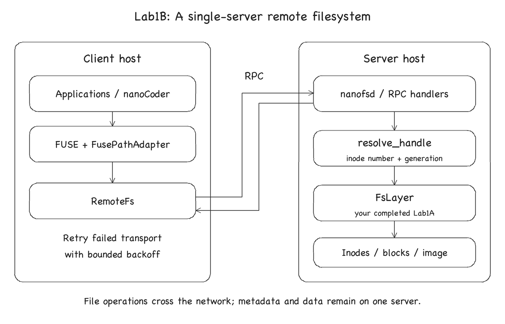

# Lab1B: Remote filesystem

## Introduction

In Lab1A, the FUSE mount program calls your filesystem through the local
adaptor. In this part, you will use RPC to access a filesystem served by
`nanofsd`. The client resolves paths and sends requests; the server stores the
inodes and file contents and runs your Lab1A implementation.

Complete Lab1A before starting. You have three new `TODO Lab1B` regions to fill:

| File | Task |
| --- | --- |
| [`nanofs/src/inode.cc`](../../nanofs/src/inode.cc) | Update the generation when allocating an inode |
| [`nanofs/src/handle.cc`](../../nanofs/src/handle.cc) | Implement `resolve_handle` |
| [`nanofs/include/nanofs/remote_fs.h`](../../nanofs/include/nanofs/remote_fs.h) | Implement `call_with_retry` |

Only edit the marked regions in these files. Keep your completed
`nanofs/src/fs.cc`; you may fix bugs in its Lab1A function bodies as needed.
RPC serialization, the client methods, server handlers and FUSE adaptor are
provided. Do not change their interfaces, the protocol or the tests for submission.

## Get the Lab1B Code

Run these commands in your existing repository on your computer, before entering
the container. First commit your Lab1A implementation, then merge the new release:

```sh
git add nanofs/src/fs.cc
git commit -m "Complete Lab1A"
git fetch https://github.com/33chilsome/cse-lab1.git lab1b
git merge FETCH_HEAD
```

If your work is already committed, skip the commit step. Commit or stash any other
local changes before merging. The release does not change `fs.cc`, so your Lab1A
implementation is preserved. If Git reports a conflict in another file, resolve
it before building; do not replace your implementation with the student skeleton.

Reuse the [Lab1 container](lab1.md#docker-container). No new image or Python
packages are needed. Unless stated otherwise, run the remaining commands from
`/work` inside that container, with `NANOFS_BUILD_DIR=/work/build-linux`.

## How Requests Reach the Server



`FusePathAdapter` resolves each path component through `RemoteFs`. The client
sends a file handle and operation arguments to `nanofsd`; the server validates
the handle and calls `FsLayer`. File data and metadata are on the same server.
The server processes filesystem requests serially. Replication, crash recovery
and concurrent transaction isolation are outside this lab.

Read the [RPC protocol](../../nanofs/proto/fs_rpc.md),
[`handle.h`](../../nanofs/include/nanofs/handle.h),
[`remote_fs.cc`](../../nanofs/src/remote_fs.cc) and
[`handlers.cc`](../../nanofs/server/handlers.cc) before implementing the tasks.

## Part 1: Inode Generations

An inode number can be reused after a file is deleted. A client may still hold
that number, so an inode number alone cannot identify the original file.
A `FileHandle` contains both the inode number and a generation counter.

In the marked region of `InodeManager::allocate_inode`, set `gen` to the previous
generation plus one. Read the previous value from the inode table entry; the
provided code writes the new value with the allocated structure block number.
The first allocation uses generation 1, including the root directory.

The counter belongs to `InodeTableEntry`, not `struct inode`. Freeing an inode
releases its structure block, while its table entry and generation remain.
Do not reset the generation in `free_inode`. Counter wraparound after billions
of allocations of the same inode number is outside this lab.

Tests: `InodeGeneration` in [`test_inode.cc`](../../nanofs/test/test_inode.cc).

## Part 2: Validate File Handles

Implement `resolve_handle` to return the inode number only when the inode is
currently allocated and its generation matches the handle. Use
`InodeManager::get` and `InodeManager::generation` for these checks.

| Condition | Result |
| --- | --- |
| Allocated inode with matching generation | Return the inode number |
| Generation differs | `Error::Stale` |
| Inode was deleted, even if its generation still matches | `Error::Stale` |
| Inode number is zero or outside the valid range | `Error::Stale` |
| Storage operation fails for another reason | Propagate that error |

Checking only the generation is insufficient: a deleted inode keeps its old
counter until it is allocated again. The RPC handlers and the handle-checking
`LocalFs` tests use this helper before calling `FsLayer`.

Tests: `ResolveHandle` and `LocalFs` in
[`test_handle.cc`](../../nanofs/test/test_handle.cc) and
[`test_local_fs.cc`](../../nanofs/test/test_local_fs.cc).

## Part 3: Retry Transport Failures

Implement `call_with_retry(attempt, retries, backoff_ms)`. The provided client
passes a callable that sends one RPC and returns a `Result<T>`.

- Call `attempt()` once, then retry at most `retries` times if it throws a
  `std::exception`. There are at most `1 + retries` attempts.
- Before each retry, wait `backoff_ms`, then twice that delay for the next retry,
  and so on. A zero delay is allowed in tests. Do not wait after the final failure.
- Return a normal result immediately, including application errors such as
  `Error::Stale` or `Error::NotFound`. These are replies, not transport failures.
- If every attempt throws, return `Error::IoError`.

The caller supplies nonnegative retry and delay values. The default client uses
three retries, a 50 ms initial delay and a 1000 ms timeout for each RPC.

A lost reply does not mean the server failed to execute the request. Retrying
may execute the same operation again. Lab1A's repeated create/delete behavior
and fixed-offset writes support this demonstration. The duplicate-delivery tests
repeat requests without intervening conflicting operations; bounded retries do
not guarantee delivery or exactly-once execution.

Tests: `CallWithRetry`, `RemoteFs` and `Handlers` in
[`test_remote_fs.cc`](../../nanofs/test/test_remote_fs.cc) and
[`test_handlers.cc`](../../nanofs/test/test_handlers.cc).

## Compile and Test

```sh
bash scripts/lab1/test-b.sh
```

The script enables `NANOFS_STAGE_B`, builds the server and client, and runs all
Lab1A and Lab1B unit tests. New tests are expected to fail until you complete the
three tasks; passing Lab1A alone is insufficient. With a correct Lab1A
implementation and all three Lab1B regions untouched, 55 tests should pass and
17 should fail. Re-run the script after edits.
To rebuild and run only the handle tests after configuring the project:

```sh
cmake --build "$NANOFS_BUILD_DIR" -j4
ctest --test-dir "$NANOFS_BUILD_DIR" -R '^(ResolveHandle|LocalFs)\.' --output-on-failure
```

`test-a.sh` configures local mode again. Run `test-b.sh` before returning to the
remote exercises so that the FUSE program includes the RPC client.

After passing the unit tests, run:

```sh
scripts/lab1/integration_test.sh b quick --seed 1
scripts/lab1/integration_test.sh b stress --seed 1
```

The script starts a server and FUSE client, creates a fresh disk image, and runs
the same workload as Lab1A over RPC. It unmounts the client and stops the server
on success. Failed runs print `FAIL preserved_logs=...`; inspect `server.log`,
`fuse.log` and the error in the terminal.

## Playing with Your Remote Filesystem

Use three terminals in the same container. To open each additional shell, run
`docker exec -it cse-2026-lab1-fuse bash` on your computer. The following commands
run inside the container. Complete the unit tests above first.

In terminal 1, start the server with a new image:

```sh
"$NANOFS_BUILD_DIR/nanofs/nanofsd" --image /tmp/cse-remote.img --format --port 8080
```

`--format` erases the disk image. Use it only to start an empty filesystem.
Keep the server running. In terminal 2, mount the remote filesystem:

```sh
scripts/lab1/start-remote.sh 127.0.0.1:8080 /tmp/cse-remote-mnt
```

Keep the mount program running. In terminal 3:

```sh
mountpoint /tmp/cse-remote-mnt
```

Confirm that it reports a mount before continuing. Then run:

```sh
mkdir /tmp/cse-remote-mnt/demo
printf 'hello RPC\n' > /tmp/cse-remote-mnt/demo/hello.txt
cat /tmp/cse-remote-mnt/demo/hello.txt
```

The output from `cat` should be `hello RPC`. To try nanoCoder on this mount,
follow [Running nanoCoder on nanoFS](nanocoder-demo.md), selecting Lab1B.

### Stop and Restart

In terminal 3, unmount first:

```sh
scripts/lab1/stop-fs.sh /tmp/cse-remote-mnt
```

Wait for the mount program in terminal 2 to exit. Then press `Ctrl+C` in terminal
1 and wait for the server to exit; this flushes the image. Restart the server
without `--format`:

```sh
"$NANOFS_BUILD_DIR/nanofs/nanofsd" --image /tmp/cse-remote.img --port 8080
```

Repeat the mount command in terminal 2. In terminal 3, verify the saved files,
remove the test file and directory, and unmount:

```sh
cat /tmp/cse-remote-mnt/demo/hello.txt
rm /tmp/cse-remote-mnt/demo/hello.txt
rmdir /tmp/cse-remote-mnt/demo
scripts/lab1/stop-fs.sh /tmp/cse-remote-mnt
```

Stop the server with `Ctrl+C` after the client unmounts. `/tmp/cse-remote.img`
belongs to the server container and survives container restarts, but is removed
if the container is deleted. Use a path under `/work` to keep it on the host.

## Grading and Handin

Pass all 72 unit tests and the full 8000-operation stress run above. Do not reduce
the operation count for grading. Save the final
`PASS stage=b profile=stress seed=1` line. The nanoCoder demo supplements these
tests and does not replace them.

Package your work inside the container:

```sh
scripts/lab1/handin.sh b YOUR_STUDENT_ID
```

Submit `handin-lab1b-YOUR_STUDENT_ID.tgz` to the Lab1B assignment on Canvas. It
contains `nanofs/src/fs.cc`, `nanofs/src/inode.cc`, `nanofs/src/handle.cc` and
`nanofs/include/nanofs/remote_fs.h`. Keep your completed A implementation in the
archive. If an archive with the same name exists, rename it before running the
script again.
