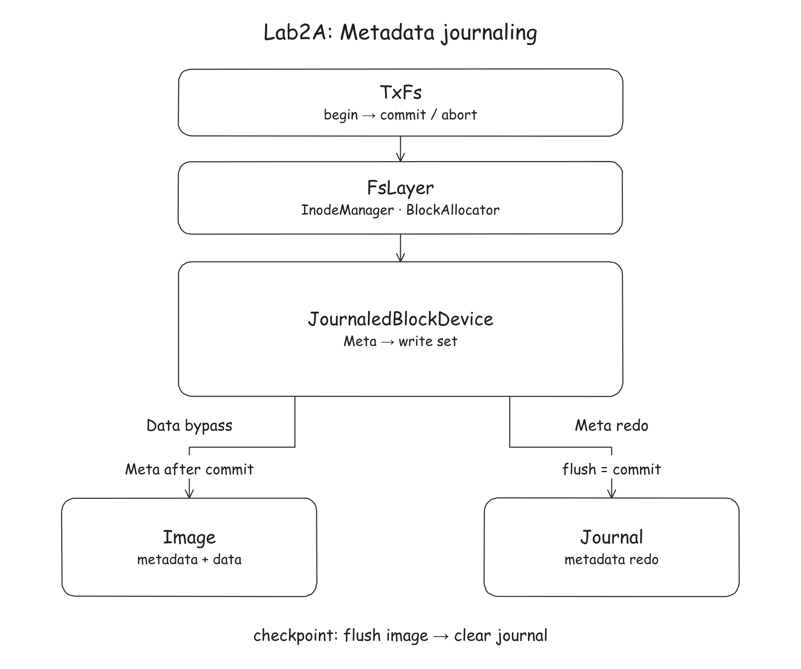

# Lab2A: Metadata journaling

## Introduction

Lab2A adds all-or-nothing atomicity for metadata updates to your Lab1
filesystem. After recovery, each mutating operation's metadata changes must
appear completely or not at all. The journal stores metadata block images
for redo; regular-file contents bypass the journal.

You implement the nine regions marked `TODO Lab2A` in
[`nanofs/src/journal.cc`](../../nanofs/src/journal.cc) and the marked Lab2A
compatibility site in
[`nanofs/src/fs.cc`](../../nanofs/src/fs.cc). `TxFs`, the journal
record format, volatile block device and crash-injection tests are provided.

Read the method contracts in
[`journal.h`](../../nanofs/include/nanofs/journal.h) and the task details
below before coding.

## Start Lab2A

Follow the [Lab2 overview](lab2.md#get-lab2-once) to merge the single release
into your completed Lab1B work. Lab2B is already present but remains inactive
while `test-a.sh` checks this stage. Use the Lab1 container with this repository
mounted at `/work`, or follow the overview to start a new one. Run the commands
below inside the container from `/work`.

### Adapt `fs.cc` for the journal

Lab1's block device ignored `BlockKind`, but the Lab2 journal uses it to decide
which blocks enter the log. In your `write_bytes` implementation, pass:

- `BlockKind::Meta` for directory contents;
- `BlockKind::Data` for regular-file contents.

If you omit the kind, `write_block` defaults to `Meta` and journals file
contents too. If you mark directory contents as `Data`, a crash can leave
committed inode metadata without its directory entry. This classification is
needed for metadata crash recovery.

Inode blocks, allocation bitmaps and indirect-pointer blocks remain metadata.
This is the only Lab1 compatibility edit required in Lab2A.

Run:

```sh
scripts/lab2/check-a.sh
```

This script checks for the two `BlockKind` names in `write_bytes`; it does not
verify that each write uses the correct kind. Run `test-a.sh` to check behavior.

## Tasks

The nine TODO regions form four groups. Use these `Journal` cases to check
each part as you implement it. Cases can depend on several methods; completing
one row alone does not guarantee that its tests pass.

| Group | Methods | Related `Journal` cases |
|---|---|---|
| Transaction buffer | `begin`, `abort`, `write_block`, `read_block`, `zero_block` | `UncommittedWritesInvisibleToImage`, `DataBlockBypassesJournal` |
| Commit | `commit` | `CommitAppliesToImage`, `CommitRejectsOversizedTransaction` |
| Log lifecycle | `checkpoint`, `reset_journal` | `CheckpointPersistsImageAndResetsJournal`, `RecoverIgnoresStaleDescriptorsAfterCheckpoint` |
| Recovery | `recover` | `RecoverRedoesCommittedStopsAtTornTail`, `CommitAppliesToImageAndIsRecoverable` |

The `Journal` cases are in
[`test_journal.cc`](../../nanofs/test/test_journal.cc).

The detailed behavior and error semantics are documented above each method in
`journal.h`. Regular-file data is not journaled, so recent content writes may
be lost after a crash. Metadata such as file size, inode pointers and
allocation bitmaps must remain consistent.

### Architecture and scope

`TxFs` wraps each mutating `FsLayer` operation in one transaction. The
`JournaledBlockDevice` sits between `FsLayer` and two independent block
devices: the image holds filesystem blocks, and the journal holds redo records.



When using a disk image, `nanofsd` and the local `nanofs_fuse --image` mode
open both `<image>` and `<image>.journal`. Keep this matching pair when
reusing or moving the filesystem: the journal may hold committed metadata
that has not yet been flushed to the image. The provided startup code calls `recover`
before serving requests; it calls `checkpoint` after formatting and on clean
shutdown. These calls are already in place.

Keep the provided interfaces and journal record format unchanged. Do not
modify tests, `server/` or `fuse-adaptor/`.

### Transaction buffer

`begin` creates a write set for the calling thread. Each thread may have one
active transaction per journaled device; nesting is not allowed. During a
transaction, `write_block` buffers `Meta` writes in that set without changing
the image, and `zero_block` stages a zero-filled block. `read_block` checks the
current thread's write set first, then reads the image. `abort` discards the set.

Use the provided helpers in `journal.cc`: `create_tx` creates the calling
thread's write set, `current_tx` finds it, and `erase_tx` removes it. They
protect access to the shared transaction map with `tx_map_mutex_`.

`Data` writes go directly to the image's volatile buffer. Remove any staged
write for the same block ID first: otherwise a zero block staged during
allocation could overwrite the file data during commit or recovery. Outside a
transaction, writes go directly to the image.

Validate the block ID and buffer size before changing either the write set or
the image, as specified in `journal.h`.

### Commit and checkpoint

A descriptor block contains `JournalDesc` (magic value, record count and
checksum), followed by the target block IDs. Use the provided
`checksum_records` helper to compute the checksum over the transaction's
record blocks when committing and recovering.

Hold `journal_lock_` throughout the commit sequence, including applying blocks
to the image and any checkpoint, so commits cannot overlap. In `commit`:

1. Reject a write set too large for one descriptor before writing the log. An
   empty set consumes no journal space.
2. If the next transaction will not fit in the journal, checkpoint first.
3. Write the record blocks at `cursor_ + 1` onward and the descriptor at
   `cursor_`, then flush the journal. A successful flush is the **commit point**.
4. Advance the log cursor and apply the metadata blocks to their locations in
   the image without flushing the image. If the cursor reaches the checkpoint
   threshold, checkpoint.

Return errors that occur before or during the journal flush. Before the flush,
the transaction has not committed. If the flush itself fails, the records may
or may not be durable; `recover` decides after a restart. Once the flush
succeeds, the transaction is committed. In this lab's simulated power-loss
model, log a later image-write or checkpoint error without reporting commit
failure; recovery will finish applying the committed metadata. Follow the
error rules in `journal.h`.

`checkpoint` flushes the image before calling `reset_journal`. That method
zeros and flushes the **entire** journal, then resets the cursor to zero.
Clearing only the first block can leave old valid descriptors for a later
recovery to replay.

### Crash model and recovery

`SimulatedBlockDevice` buffers writes until `flush()`. In this model, each
individual block is persisted atomically, but a flush of several blocks can
stop between blocks. `crash_at_flush(nth, k)` injects power loss after `k`
dirty blocks have been persisted by the selected device's `nth` subsequent
flush. `k` can range from zero to all dirty blocks in that flush. The harness
then calls `reboot()` on both devices to discard unflushed writes before
recovery. The descriptor's checksum helps detect an incomplete transaction;
the model does not simulate partially written bytes within a block.

At startup, before serving filesystem requests, `recover` scans the journal
from block 0. For each valid transaction, copy its record blocks to the image
locations listed in the descriptor. Stop at an invalid magic value, a record
count that would extend past the journal, or a checksum mismatch; do not replay
that transaction or anything after it.

If any transaction was replayed, flush the image. After the scan and any
required image flush succeed, call `reset_journal`, even if nothing was
replayed. A block read error is different from invalid log contents: return
the error without clearing the journal, which may still contain committed
transactions needed for recovery.

## Compile and test

Inside the Docker container, from `/work`:

```sh
scripts/lab2/test-a.sh
```

After `test-a.sh` has configured the build, you can rebuild and run selected
groups while developing:

```sh
cmake --build "${NANOFS_BUILD_DIR:-build}" -j4
ctest --test-dir "${NANOFS_BUILD_DIR:-build}" -R '^Journal\.' \
  --output-on-failure --timeout 10
ctest --test-dir "${NANOFS_BUILD_DIR:-build}" -R '^(JournalFs|JournalCrash)\.' \
  --output-on-failure --timeout 10
ctest --test-dir "${NANOFS_BUILD_DIR:-build}" -R '^JournalConcurrency\.' \
  --output-on-failure --timeout 10
```

To select one case from the table, use its full `Suite.Case` name, for example
`-R '^Journal\.CommitAppliesToImage$'` in the command above.

The `JournalFs` and `JournalCrash` cases are in
[`test_journal.cc`](../../nanofs/test/test_journal.cc). They check the journal
through filesystem operations. `JournalConcurrency` checks transactions from
different threads:

| Suite | What to check |
|---|---|
| `JournalFs` | `CreateSurvivesCrashAfterCommit` checks committed metadata recovery; `WriteFullBlockReadsBackNoCrash` and `MultiBlockHighOffsetWriteReadsBack` check normal file writes through `TxFs`. |
| `JournalCrash` | `CreateAllOrNothing` and `UnlinkAllOrNothing` check metadata consistency after simulated power loss during those operations. |
| `JournalConcurrency` | `ReaderDoesNotSeeAnotherThreadsUncommittedWrite` checks separate thread write sets; `ConcurrentCommitsBothPersistAndRecover` checks concurrent commits and recovery. |

The concurrency cases are in
[`test_journal_concurrent.cc`](../../nanofs/test/test_journal_concurrent.cc).

The script also runs all Lab1 tests to check that Lab2 has not broken your
existing filesystem.

Each test has a default timeout of 10 seconds. CTest reports a timed-out case
as `Timeout` and continues with the other cases; the script exits with a
nonzero status if any case fails. One timeout is expected before you implement
the journal. After completing Lab2A, all cases must pass without timing out.

### Starter baseline

With a completed Lab1B implementation and the untouched Lab2A journal stubs,
the development container runs 87 public CTest cases: **72 pass and 15 fail**
(one failure is a timeout). All 72 Lab1 cases still pass and the 15 new Lab2A
cases are expected to fail until you implement the journal. `test-a.sh` selects
the A configuration, so unfinished Lab2B code is not tested at this checkpoint.

### Understanding crash-test failures

In `test_journal.cc`, `expect_all_or_nothing` reruns an operation from the
same initial state for each device, flush number and persisted-block count.
After recovery, the root listing (name, inode ID, type, link count and size)
must equal either the initial listing or the listing after a successful operation. On a mismatch, the test prints all
three listings.

The `expect_consistent` helper also checks the small test filesystem for:

- directory entries pointing to unallocated or free inodes;
- allocated inodes other than the root with no directory entry referencing them;
- direct block pointers whose blocks are marked free in the bitmap.

For example, `leaked inode 3 ... image flush 1, 2 blocks landed` means inode 3
remained allocated without a directory entry after the first image flush
persisted two blocks and power was lost. Check which metadata updates were
committed and which were replayed. These cases start with an empty journal
and do not need a checkpoint, so a correct commit flushes only the journal.
The harness also tries image-flush failures to catch metadata being persisted
before the commit point. If journal unit tests pass but these tests fail,
check your Lab1 metadata updates as well as `commit` and `recover`.

### Optional manual recovery check

Once these tests pass, you can optionally check recovery using the
[Lab1B remote-mount instructions](../lab1/lab1b.md#playing-with-your-remote-filesystem).
Write a file, stop `nanofsd` with `kill -9` instead of `Ctrl+C`, then restart
it with the same image and journal files, without `--format`. Committed
metadata should recover; recent file contents may be lost because data is not
journaled.

## Grading

See the [Lab2 grading and handin instructions](lab2.md#grading-and-handin).

## References

- [`journal.h`](../../nanofs/include/nanofs/journal.h): journal format, transaction methods and error handling.
- [`txfs.h`](../../nanofs/include/nanofs/txfs.h): how each mutating filesystem operation begins, commits or aborts a transaction.
- [`block.h`](../../nanofs/include/nanofs/block.h): block-device interfaces, `BlockKind` and simulated power loss.
- [`inode.h`](../../nanofs/include/nanofs/inode.h): inode layout and allocation metadata.
- [Lab1A](../lab1/lab1a.md): the filesystem operations whose metadata this journal protects.
