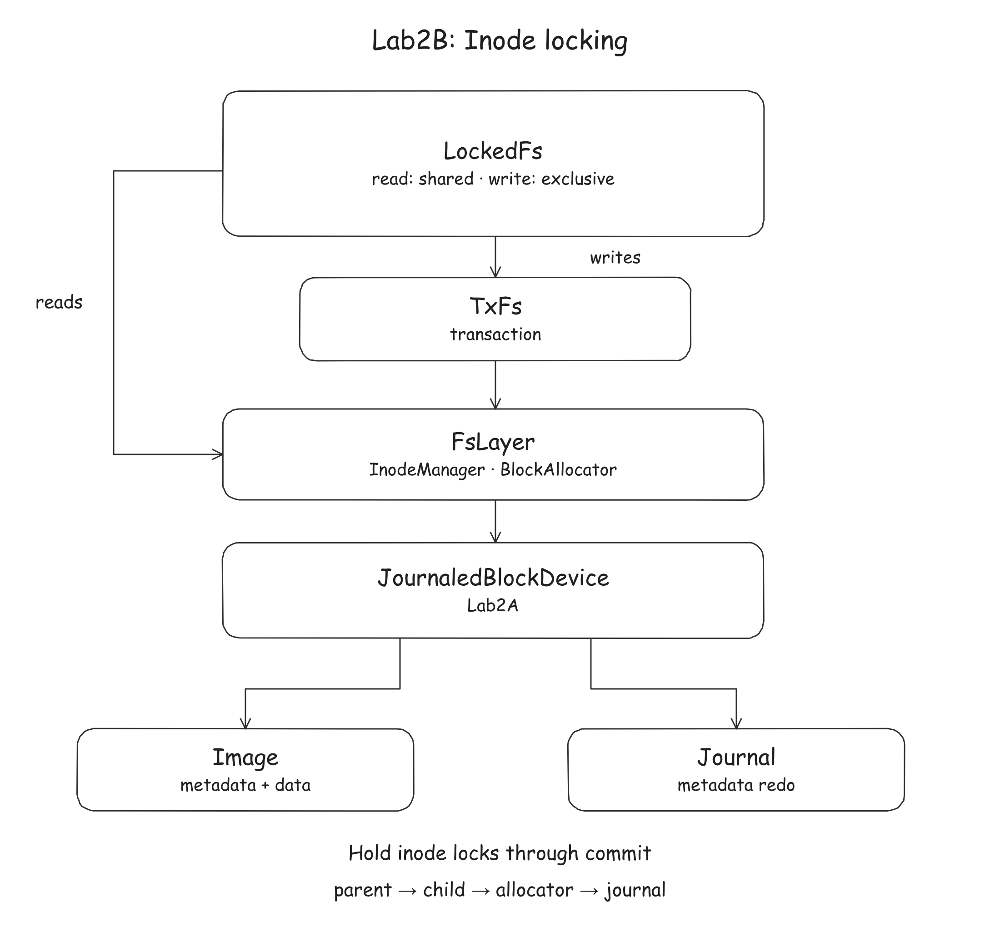

# Lab2B: Concurrent filesystem operations

## Introduction

Lab2B builds on your completed Lab2A journal and adds before-or-after behavior
for concurrent filesystem operations. Reads use shared per-inode locks; writes
use exclusive locks held through journal commit. A lazy allocator lock protects
shared inode and block allocation metadata.

You implement the nine regions marked `TODO Lab2B` in
[`nanofs/src/locked_fs.cc`](../../nanofs/src/locked_fs.cc). Also check the three
marked Lab2B compatibility sites in
[`nanofs/src/fs.cc`](../../nanofs/src/fs.cc) and adapt your Lab1 code if needed,
as described below. The lock table,
allocator lock and transaction layer are provided. Read
[`locked_fs.h`](../../nanofs/include/nanofs/locked_fs.h) and the task
details below before coding.

## Continue from the Lab2A checkpoint

Complete Lab2A and make a checkpoint commit:

```sh
git add nanofs/src/fs.cc nanofs/src/journal.cc
git commit -m "Complete Lab2A"
```

Continue in the same branch and working directory; no second fetch or merge
is needed.

Continue using the Lab1/Lab2A Docker container with this repository mounted at
`/work`. Run the remaining commands inside that container from `/work`.

### Adapt `fs.cc` for virtual lookup

`LockedFs` overrides `lookup` to acquire a directory lock. A mutating operation
already holds the parent lock, so an internal unqualified virtual lookup would
try to acquire the same non-recursive lock again.

If your Lab1 implementations of `make_node`, `unlink` or `rmdir` call
`lookup(parent, name)` or `this->lookup(parent, name)` internally, change those
calls to:

```cpp
FsLayer::lookup(parent, name)
```

An implementation that searches the directory without calling virtual
`lookup` needs no such change. Public `lookup` calls must still use the locking
override.

Run:

```sh
scripts/lab2/check-b.sh
```

This repeats the Lab2A block-kind check and checks for common unsafe `lookup`
calls in `fs.cc`. These are source checks; run `test-b.sh` to check behavior.

## Tasks

| Operations | Required protection |
|---|---|
| `lookup`, `readdir` | shared lock on the directory inode |
| `getattr`, `read_file` | shared lock on the target inode |
| `write_file`, `setattr` | exclusive target lock and allocator scope |
| `make_node` | exclusive parent lock and allocator scope |
| `unlink`, `rmdir` | exclusive parent, then exclusive child if present, then allocator scope |

Follow the lock order and method contracts in `locked_fs.h`.

### Architecture and scope

`LockedFs` sits above `TxFs`, which uses your completed Lab2A journal.
Its inode locks surround the filesystem calls; the transaction layer and
journal are underneath.



Keep the provided lock-table and transaction interfaces unchanged. Do not
modify tests, `server/` or `fuse-adaptor/`.

### Why the allocator also needs a lock

Each inode structure occupies its own block, but different inodes share
allocation bitmap and inode-table blocks. Two operations holding different
inode locks can therefore still update the same metadata block. For example,
one transaction may allocate a block while another frees a different block
tracked by the same bitmap block. If both modify old copies in their own
write sets, the later whole-block commit can overwrite the earlier bit change.
Serializing commits alone does not prevent this: both transactions may have
read the bitmap before either committed.

`AllocatorLock` protects allocation and freeing from the first access to
allocation metadata through commit. The provided allocators call
`engage_current()` to acquire it on first use within a scope. An operation that neither allocates nor frees resources
does not acquire this lock.

### Read and mutating operations

Each read takes one target inode's shared lock and calls the corresponding
`FsLayer` method without starting a transaction or creating an allocator scope.
For both reads and writes, if `lockable(id)` is false, call the base method
without taking an inode lock and let it return the error. Never index the lock
table with an invalid ID.

For writes, create an `AllocatorLock::Scope` after acquiring the required inode
locks, then call the corresponding `TxFs` method. Keep the guards alive until
that call returns, including its journal commit. Holding locks through commit
is strict two-phase locking.

`unlink` shows the complete pattern:

```cpp
Result<void> LockedFs::unlink(inode_id parent, const std::string& name) {
  if (!lockable(parent)) return TxFs::unlink(parent, name);
  auto pg = locks_.lock_exclusive(parent);
  std::unique_lock<std::shared_mutex> cg;             // empty until the child is known
  if (auto child = FsLayer::lookup(parent, name); child && lockable(*child))
    cg = locks_.lock_exclusive(*child);
  AllocatorLock::Scope scope(alloc_lock_);           // free() inside will engage it
  return TxFs::unlink(parent, name);                 // guards outlive the commit inside
}
```

`rmdir` follows the same pattern; the other writes need only one inode lock.
The complete lock order is **parent inode, child inode, allocator, journal**.
There are no hard links or rename in this lab, so taking the parent before the
child does not form a lock cycle.

## Compile and test

```sh
scripts/lab2/test-b.sh
```

After `test-b.sh` has configured the build, you can rebuild and run only the
locking suites:

```sh
cmake --build "${NANOFS_BUILD_DIR:-build}" -j4
ctest --test-dir "${NANOFS_BUILD_DIR:-build}" \
  -R '^(InodeLockTable|AllocatorLock|LockedFsBasic|LockedFsConcurrent)\.' \
  --output-on-failure --timeout 10
```

### Starter baseline

With completed Lab1B and Lab2A work, and the untouched Lab2B `LockedFs`
stubs, the development container runs 110 public CTest cases: **94 pass and
16 fail**. The 94 passes are prior-stage regression and provided lock-component
tests. All ten `LockedFsBasic` and six `LockedFsConcurrent` cases fail. The
cumulative CTest pass rate does not represent the Lab2B grade.

### Basic operation tests

`LockedFsBasic` checks individual operations in a single thread. It prepares
files through the provided `TxFs` layer using your completed Lab2A journal, so
you can test `read_file` before implementing `LockedFs::make_node`.

| Operation | Related `LockedFsBasic` cases |
|---|---|
| `lookup` | `LookupExistingAndMissing` |
| `getattr` | `GetattrReportsFileSize` |
| `readdir` | `ReaddirListsSeededEntry` |
| `read_file` | `ReadFileReturnsSeededBytes` |
| `write_file` | `WriteFilePersistsBytes` |
| `setattr` | `SetattrTruncatesFile` |
| `make_node`, through `create` and `mkdir` | `CreateAddsFile`, `MkdirAddsDirectory` |
| `unlink` | `UnlinkRemovesSeededFile` |
| `rmdir` | `RmdirRemovesSeededDirectory` |

See [`test_locked_fs_basic.cc`](../../nanofs/test/test_locked_fs_basic.cc).
These tests check return values and filesystem contents, not concurrent
execution. Passing them does **not** establish correct locking.
`WriteFilePersistsBytes` checks immediate readback without simulating a crash.

### Concurrent operation tests

Once the relevant operations work, run `LockedFsConcurrent` to check them
under contention:

| `LockedFsConcurrent` case | Operations and behavior checked |
|---|---|
| `ConcurrentCreateDifferentDirsNoDoubleAlloc` | Creating files under different parents must allocate distinct inodes. |
| `ConcurrentCreateSameDirAllPresent` | Concurrent creates in one directory must not lose entries. |
| `ReadWriteIsolationNoTear` | `read_file` racing with `write_file` must return a complete old or new value across two blocks. |
| `ConcurrentGrowShrinkNoBlockLeakOrDoubleAlloc` | `write_file` and `setattr` on different files must not leak blocks, allocate a block twice or leave a live block marked free. |
| `ConcurrentMkdirRmdirNoInodeLeakOrDoubleAlloc` | `mkdir` and `rmdir` under different parents must leave distinct live inodes marked allocated, with the expected inode and block counts. |
| `ConcurrentCreateUnlinkNoDeadlock` | Concurrent create/unlink loops in the root directory must succeed, finish without deadlock and leave the directory empty. |

See [`test_locked_fs_concurrent.cc`](../../nanofs/test/test_locked_fs_concurrent.cc).
Each case calls several filesystem methods to prepare data and run concurrent
operations. An unfinished method can cause a failure during setup. To run one
case, replace the `-R` expression in the command above, for example with
`-R '^LockedFsConcurrent\.ReadWriteIsolationNoTear$'`.

`InodeLockTable` and `AllocatorLock` test the provided lock components. They
should keep passing, but do not check whether your `LockedFs` uses them
correctly. Keep all Lab1 and Lab2A regression tests passing as well.

### Optional FUSE acceptance

After all required tests pass, a FUSE-enabled container can run:

```sh
scripts/lab2/fuse-acceptance.sh
```

Use the FUSE-enabled container from the [Lab2 setup](lab2.md#development-container).
Skip this optional acceptance test in a container without `/dev/fuse`.

The script mounts a temporary in-memory filesystem, checks concurrent file
creation and contents, then checks that a reader racing a writer sees only
complete values. Success prints `FUSE ACCEPTANCE PASS`. If mounting or the
workload fails, the script prints the error and a preserved log directory;
read `fuse.log` there. For a mount failure, also check the container options
above. This test does not check crash recovery.

### Optional bonus: outperform the global lock

The target is **at least 2.00x faster than the provided `GlobalLockFs`** in
[`nanofs/stress/concurrent_bench.cc`](../../nanofs/stress/concurrent_bench.cc).
That baseline uses one mutex around every filesystem operation, held through
commit for writes, so all operations are serialized. The benchmark compares
it with **your `LockedFs` implementation**, using separate identically formatted
device stacks and the same thread count and operation sequence.

Implement the inode-level locking policy above so independent operations can
run concurrently. The benchmark pre-creates one file per thread. Each thread
performs 99 reads followed by one in-place overwrite per round (99% reads),
without allocating new blocks during the timed workload. By default it uses up
to eight threads and 800 rounds per thread. This workload tests whether independent reads can
run in parallel; a global lock or unnecessary shared-resource locking reduces
that concurrency.

First pass all correctness tests, then run the command below inside the
container. The benchmark is separate from the 110 public CTest cases and does
not require FUSE. It prints `global-lock`, `locked-fs` and `speedup`; `PASS`
means the measured speedup reached 2.00x. Timing depends on available CPU
resources and other host activity; run it when your machine is otherwise idle.

Run the optional benchmark in a separate Release build, matching the grading
configuration without changing your development build:

```sh
bonus_build="${NANOFS_BUILD_DIR:-build}-bonus"
cmake -S . -B "$bonus_build" -DCMAKE_BUILD_TYPE=Release \
  -DNANOFS_STAGE_B=ON -DNANOFS_LAB2B=ON
cmake --build "$bonus_build" -j4 --target run_concurrent_stress
```

## Grading

See the [Lab2 grading and handin instructions](lab2.md#grading-and-handin).

## References

- [`locked_fs.h`](../../nanofs/include/nanofs/locked_fs.h): per-operation lock requirements and lock order.
- [`inode_lock_table.h`](../../nanofs/include/nanofs/inode_lock_table.h): shared and exclusive inode locks and their RAII guards.
- [`allocator_lock.h`](../../nanofs/include/nanofs/allocator_lock.h): allocator scopes and locking on first use.
- [`txfs.h`](../../nanofs/include/nanofs/txfs.h): the transaction calls that must complete before releasing the locks.
- [`inode.h`](../../nanofs/include/nanofs/inode.h) and [`block.h`](../../nanofs/include/nanofs/block.h): inode and block allocation protected by the allocator lock.
